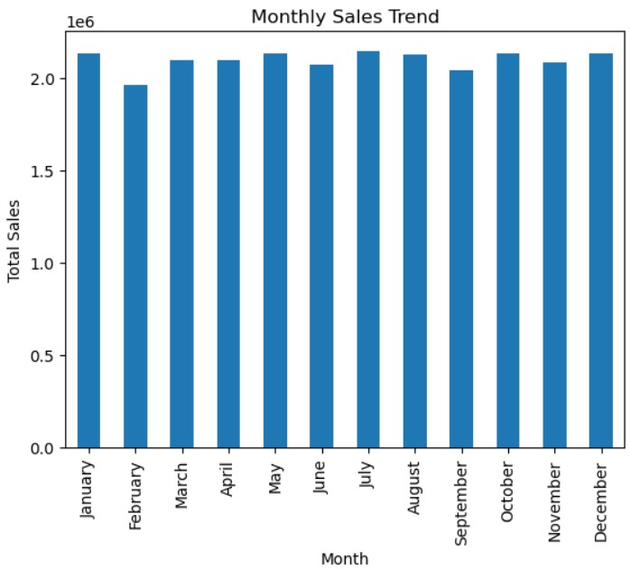

# 📊 End-to-End Data Analytics Pipeline

## https://github.com/swanandihelambe/data-analytics-pipeline

## 📌 Problem Statement
Businesses generate large volumes of transactional data, but raw data alone does not provide meaningful insights.

This project focuses on transforming raw transaction data into actionable insights while ensuring data privacy through anonymization techniques.

---

## 📌 Overview
This project demonstrates a complete data analytics workflow using Python, including:
- Data cleaning  
- Data anonymization  
- Exploratory data analysis  
- Data visualization  

The dataset contains transaction-level information such as customer details, product categories, purchase amounts, and payment methods.

---

## 🎯 Objective
- Clean and preprocess raw data  
- Apply anonymization techniques to protect sensitive information  
- Analyze transaction data to identify patterns and trends  
- Extract business insights from the data  

---

## 🛠️ Tools & Technologies
- Python  
- Pandas  
- Matplotlib  

---

## 🔄 Workflow

1. **Data Cleaning**  
   - Removed duplicates and handled missing values  

2. **Data Anonymization**  
   - Removed sensitive column: `User_Name`  
   - Converted `Age` into grouped categories (`Age_Group`)  

3. **Feature Engineering**  
   - Converted `Transaction_Date` into datetime format  
   - Extracted month from date for trend analysis  

4. **Data Analysis**  
   - Monthly sales trend analysis  
   - Product category analysis  
   - Payment method distribution  

5. **Visualization & Insights**  
   - Created visualizations to identify patterns and trends  

---

## 📊 Visualization

---

## 📈 Key Insights
- Sales remain relatively stable throughout the year, indicating consistent demand  
- February shows the lowest sales, possibly due to fewer days  
- Mid-year and festive months (July, October, December) show slightly higher sales  
- The business is not heavily dependent on seasonal trends  

---

## 🧠 Key Learning
Handling real-world data requires balancing **data privacy and usability**.  
This project demonstrates how anonymization techniques can be applied without losing analytical value.

---

## 🚀 Future Improvements
- Build an interactive dashboard using Power BI or Tableau  
- Integrate SQL for advanced querying  
- Automate the pipeline for real-time data processing  

---

## 🔗 Author
Swanandi Helambe
